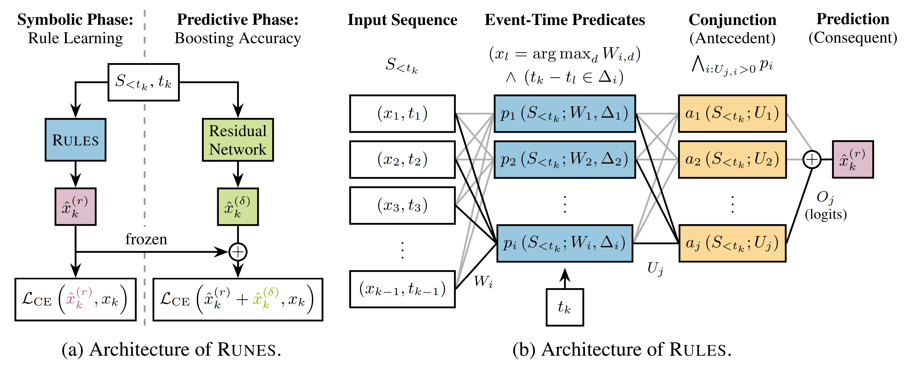

# What Comes Next and Why: Interpretable Next-Event Prediction with Neuro-Symbolic Rules
This repository contains the code for our NeurIPS 2026 paper.
It implements RULES, an inherently interpretable neuro-symbolic model that learns sequential rules for next-event prediction, and its extension RUNES (**Ru**le **N**etwork for **E**vent **S**equence), which transparently combines RULES with a residual network for improved accuracy.
Both models operate on timestamped sequences with categorical values, i.e., event sequences.
A detailed description and empirical evaluation of both models can be found in our paper.



## Basic Usage
We implement RULES and RUNES as PyTorch Lightning models, so they can be used as standard PyTorch models or with the extended PyTorch Lightning functionality.
Here we explain the high-level usage; detailed examples can be found in the scripts that reproduce our experiments, e.g., see [Example Usage (Minimal Reproduction)](#example-usage-minimal-reproduction).

### RULES
#### Forward Pass
A standard template for performing a forward pass with RULES is:
```python
# import the model
from models.rules import Rules

rules_model = Rules(*args, **kwargs) # initialize the model
out = rules_model(x, sampling_times) # perform a forward pass
```
Here, `x` is a tensor of shape `[batch_size, sequence_length]` that contains categorical events encoded as integers, and `sampling_times` is a tensor of shape `[batch_size, sequence_length]` that contains the non-negative real-valued timestamps associated with the events in `x`.
If RULES is initialized with the regular sampling flag (`rules_model.regular_sampling == True`), the model implicitly uses integer timestamps `0, 1, 2, ..., sequence_length-1` and `sampling_times` can be set to `None`.

The output `out` is a dictionary, where `out['prediction_logits']` of shape `[batch_size, sequence_length, sequence_dim]` gives the softmax logits of the predictions for each timestep.
The predictions of RULES are computed with **causal masking**, i.e., a prediction at time `t` only depends on observed events before `t`.

To use RULES with the exact Boolean representations of its hidden layers, we can set
```python
rules_model.symbolic = True
```
which internally switches the mode of the forward pass.
This is the model that we get in the limit of temperature annealing and use for evaluations, but it is non-differentiable in its hidden layers, so it cannot be used for training unless we only want to optimize the output layer.

#### Training with PyTorch Lightning
To train with PyTorch Lightning, we can use:
```python
import lightning as L

trainer = L.Trainer(*args, **kwargs)
trainer.fit(rules_model, train_loader, val_loader)
```
For training with Lightning, the expected batch form is a tuple `(x, sampling_times, padding_mask, target_mask, sequence_length, true_rules)`, where
- `x` and `sampling_times` are the tensors described above.
- `padding_mask` is a boolean tensor of shape `[batch_size, sequence_length]`, where `True` indicates padding elements in `x` that should be ignored in the loss calculation. It can be set to None if there is no padding.
- `target_mask` is a boolean tensor of shape `[batch_size, sequence_length]`, where `True` indicates the only elements in `x` that should be included in the loss calculation, while all others will be ignored. It can be set to None, in which case all elements (except for padding) are included in the loss.
- `sequence_length` and `true_rules` are ignored by all training and testing steps. They are there for debugging and can be set to `None` without changing behavior.

#### Extracting the Rules from RULES
After training RULES (including temperature annealing), we can extract the learned rules from it:
```python
# Optional: prune always-on and always-off neurons to get crisper rules.
# This produces an equivalent model (for the training data) if the min and max thresholds are set to 0 and 1, respectively.
rules_model.symbolic = True # use symbolic hidden layers for evaluation
rules_model.sparcify(train_loader, threshold_min_usage=0.0, threshold_max_usage=1.0) 

# extract rules according to the given thresholds
# sensible default parameters are: quantile_q=0.95, max_min_threshold=0.9, inclusion_threshold=0.95
rule_set, rule_set_neg = rules_model.get_rule_set(quantile_q, max_min_threshold, inclusion_threshold)
```
`rule_set` is the standard set of sequential rules discussed in the paper, while `rule_set_neg` includes negative associations, where events predict the absence of future events.
To print rules to a file in human-readable format, we can use
```python
from data.real_data import print_rules_to_file

print_rules_to_file(rule_set, int_to_symbol, file_path)
```
where `int_to_symbol` is a dictionary that maps each integer event to its semantic (string) representation. 

#### Symbolic Refinement of Rules
An extracted rule set (or any other rule set) can be efficiently refined for a given dataset using symbolic algorithms. 
For each rule, our algorithms guarantee preservation of its support on the given dataset, while maintaining or increasing its confidence and reducing its size.
To refine a rule set, we can run (the order of function calls is important):
```python
from data.utils import (
    remove_unsupported_rules,
    simplify_antecedent_predicates,
    tighten_delay_intervals,
)

rule_set, num_removed_rules = remove_unsupported_rules(train_data_samples, rule_set, regular_sampling)
rule_set, num_removed_predicates = simplify_antecedent_predicates(train_data_samples, rule_set, regular_sampling)
rule_set, avg_interval_reductions = tighten_delay_intervals(train_data_samples, rule_set, regular_sampling)
```

**Note:** For a more comprehensive reference on working with symbolic rule sets and additional functionality (e.g., calculating support and confidence), you can check out the `aggregate_results_single_dataset_real` function in `src/metrics_aggregation.py`.

#### Embedding a Rule Set into RULES
An existing rule set can be used to define the hidden layers of RULES using
```python
from models.rules import initialize_from_rules
rules_model = initialize_from_rules(rule_antecedents, *args, **kwargs)
```


### RUNES
RUNES combines RULES with a residual model by adding the residual model's logits to those of RULES. 
The residual model can be *any* model that outputs softmax logits for the next event (class) in the sequence; it should only follow the temporally causal processing of information (so that future events cannot influence earlier predictions) and be trainable based on the summed logits (as, e.g., any classical PyTorch network).
The high-level pattern for this is:

```python
from models.rules import Rules

rules_model = Rules(*args, **kwargs) # initialize RULES
# 
# [Train your RULES model here and freeze its parameters after]
#
# use RULES with symbolic hidden layers
rules_model.symbolic = True

# initialize the residual network
residual_model = YourResidualModel(*args, **kwargs)

# get the prediction logits of RULES and the residual model
rules_out: dict[str, torch.Tensor] = rules_model(x, sampling_times)
residual_out: dict[str, torch.Tensor] = residual_model(x, sampling_times)         
rules_logits = rules_out['prediction_logits']
residual_logits = residual_out['prediction_logits']

# combine both logits additively
prediction_logits = rules_logits + residual_logits
```
In our experiments, we combine RULES with a residual transformer network.
The code for this version of RUNES is in `src/models/runes.py`.


## Notes on Naming
In the code, we sometimes use different terminology than in the paper. 
Below is a mapping of important terms to help you understand the correspondence.

| Code                    |  Paper                  | 
|-------------------------|-------------------------|
| (rule) head             | antecedent              |
| (rule) tail             | consequent              |
| item, element           | event                   |
| sequence dimension      | vocabulary size         |
| max. relative distance  | maximum lookback window |


## Code Structure
```text
project
|
├── cfgs                                           🠔 folder to write model configs
|   ├── real/...                                   🠔 configs for real-world datasets
|   └── synthetic/...                              🠔 configs for synthetic datasets (configs for our experiments are automatically created via data_generation.py)
|
├── data/...                                       🠔 folder to store datasets in the required format (datasets for our experiments are automatically created via data_generation.py)
|
├── logs                                           🠔 folder for storing results (results are generated by running the code)
|   ├── real/...                                   🠔 logs for real-world data
|   └── synthetic/...                              🠔 logs for synthetic data
|
├── resources/...                                  🠔 figures for the README
|
├── src                                            🠔 code
|   | 
|   ├── data
|   |   ├── dataset_files/...                      🠔 saved real-world datasets, not including the Amazon dataset
|   |   ├── real_data.py                           🠔 parsing of real-world datasets and conversion into our data formats
|   |   ├── synthetic_data.py                      🠔 synthetic data generation
|   |   └── utils.py                               🠔 PyTorch dataset classes and algorithms for improving a symbolic rule set on given data
|   |
|   ├── models
|   |   ├── interpretable_prediction_baselines.py  🠔 utilities for PPM and tree methods
|   |   ├── rope_transformer.py                    🠔 RoPE transformer implementation
|   |   ├── rules.py                               🠔 RULES (our rule network)
|   |   ├── runes.py                               🠔 RUNES (RULES + transformer residual network)
|   |   └── utils.py                               🠔 loss function and some other model-related functionality
|   |
|   ├── data_generation.py                         🠔 file to generate datasets as well as configs for the synthetic experiments
|   ├── eval_utils.py                              🠔 utilities for running experiments
|   ├── evaluation_get_mean_std.py                 🠔 compute mean and standard deviation results on real data
|   ├── evaluation_get_run_times.py                🠔 benchmark runtimes for RULES and the transformer on synthetic data
|   ├── evaluation_interpretability_results.py     🠔 compute model complexity metrics for RULES, PPM, CatBoost and XGBoost
|   ├── evaluation_residual_network_behavior.py    🠔 track per-event metrics about RULES and the residual network in RUNES
|   ├── evaluation_run_ppm_markov.py               🠔 run the PPM Markov Model
|   ├── evaluation_run_random.py                   🠔 run RULES on random datasets
|   ├── evaluation_run_real.py                     🠔 run RULES and the transformer on real-world datasets
|   ├── evaluation_run_runes.py                    🠔 run RUNES on real world datasets
|   ├── evaluation_run_synthetic.py                🠔 run RULES, ground-truth RULES* (RULES-GT), and the transformer on synthetic datasets
|   ├── evaluation_run_tree_boosting.py            🠔 run CatBoost or XGBoost
|   ├── evaluation_run_with_processed_rules.py     🠔 run RULES with processed and re-embedded rules (antecedents)
|   ├── latex_utils_paper.py                       🠔 scripts to generate LaTeX code for tables and plots
|   ├── metrics.py                                 🠔 code for calculating metrics
|   ├── metrics_aggregation.py                     🠔 code to aggregate metrics for multiple models and across different datasets
|   └── plots.py                                   🠔 additional plotting
|
├── environment.yaml                               🠔 conda environment file
├── environment.lock.yaml                          🠔 exact snapshot of the environment used in experiments
└── README.md                                      🠔 this file
```


## Dependencies
To reproduce the experiments or run the models, install the Conda environment provided in `environment.yaml`:
```bash
conda env create -f "./environment.yaml"
```

Then activate the environment:
```bash
conda activate runes
```
**Note 1:** To run RULES and RUNES, you do not need to install the dependencies for CatBoost and XGBoost. 
These are there to obtain baseline results.

**Note 2:** `environment.lock.yaml` contains the exact package versions used to produce the results reported in our paper. 
It is provided for documentation and is not required to run the code.

### Real-World Datasets
We include dataset files in `src/data/dataset_files` except for the Rolling Mill dataset and the Amazon dataset.
These can be obtained as follows:
- **Rolling Mill:** The rolling mill dataset from [Discovering Sequential Patterns with Predictable Inter-event Delays](https://doi.org/10.1609/aaai.v38i8.28676) by Cüppers et al. (2024) can be downloaded from their [project page](https://eda.rg.cispa.io/prj/hopper/). To run on it, place `rolling-mill.dat` in `src/data/dataset_files/`.
- **Amazon:** The Amazon dataset from [Open e-commerce 1.0, five years of crowdsourced U.S. Amazon purchase histories with user demographics](https://www.nature.com/articles/s41597-024-03329-6) by Berke et al. (2024) is available at https://doi.org/10.7910/DVN/YGLYDY. To run on it, download `amazon-purchases.csv` and place it in `src/data/dataset_files/`.


**Included Datasets and Licenses:**
- **Holidays:** Generated via the [holidays package](https://pypi.org/project/holidays/).
- **Chorales:** [Bach Chorales](https://archive.ics.uci.edu/dataset/25/bach+chorales) by Darrell Conklin (https://doi.org/10.24432/C5GC7P), obtained from the [UCI Machine Learning Repository](https://archive.ics.uci.edu/), licensed under [CC BY 4.0](https://creativecommons.org/licenses/by/4.0/legalcode). Included unmodified.
- **Commits:** Samba commit data from [Mining Periodic Patterns with a MDL Criterion](https://doi.org/10.1007/978-3-030-10928-8_32) by Galbrun et al. (2018), obtained from their [GitHub project](https://github.com/nurblageij/periodic-patterns-mdl) under the [Apache License 2.0](https://www.apache.org/licenses/LICENSE-2.0); see `src/data/dataset_files/COMMITS_LICENSE`. Renamed (originally `commit_auth_data.dat`) and converted from `.dat` to `.txt`, otherwise unmodified.


## Example Usage (Minimal Reproduction)
To verify that the code runs correctly and reproduces the core behavior reported in the paper, you can run the following minimal reproduction steps on a single real-world dataset.
1. Ensure that the Conda environment is active
    ```bash
    conda activate runes
    ```
2. Create the dataset files for one dataset, e.g., Holidays. Run the following Python code from the repository root (all scripts assume that paths are relative to it):
    ```python
    import sys
    sys.path.insert(0, 'src') # make the code in src/ importable

    from data.real_data import materialize_holidays_dataset
    from data_generation import REAL_DATA_DIR

    materialize_holidays_dataset(save_dir=REAL_DATA_DIR)
    ```
    Alternatively, generate **all** dataset files (synthetic + real data, which can take some time):
    ```bash
    python src/data_generation.py
    ```
    **Note:** The Rolling Mill and Amazon datasets are generated last and require `rolling-mill.dat` and `amazon-purchases.csv`, respectively (see [Real-World Datasets](#real-world-datasets)). Without these files, the script fails at the end, after all other datasets have been generated.

3. Train RULES on Holidays:
    ```bash
    python src/evaluation_run_real.py --dataset holidays_irregular --num_workers_dataloader 4 --run_with_transformer t --split_off_val_rules t
    ```
4. Train RULES with re-embedded processed antecedents on Holidays:
    ```bash
    python src/evaluation_run_with_processed_rules.py --synthetic f --dataset holidays_irregular --regular f --num_workers_dataloader 4 --split_off_val_rules t
    ```
5. Train RUNES, where RULES with processed antecedents is the base model, on Holidays:
    ```bash
    python src/evaluation_run_runes.py --synthetic f --dataset holidays_irregular --regular f  --processed_rules t --num_workers_dataloader 4
    ```
Next to the trained models, this produces the following files in `logs/real/holidays_irregular/`: `ruleset.txt`, which contains the learned rules, as well as `aggregated_results.yaml`, `rules_processed_rules_aggregated_results.yaml`, and `runes_processed_rules_aggregated_results.yaml`, which contain performance metrics for RULES, RULES with processed rules, and RUNES, respectively.


## Reproducing Experiments from the Paper
With the Conda environment active, generate the datasets and configuration files:
```bash
python src/data_generation.py
```
If you wish to change directory names or paths, you can do so in this file. The other scripts will use the directories set here.

**Note:** As in the minimal reproduction, `rolling-mill.dat` and `amazon-purchases.csv` have to be available (see [Real-World Datasets](#real-world-datasets)); otherwise, the script fails at the end, after all other datasets have been generated.


Now you can run experiments on any of the synthetic, real-world, or random datasets. The scripts depend on each other's results as follows.

### Script Dependencies
All scripts require the datasets and configs from `data_generation.py`, except for `evaluation_get_run_times.py`, which generates its own data and can be run independently.

```text
Synthetic data:
  evaluation_run_random.py ───────┐
  evaluation_run_synthetic.py ────┤
  evaluation_run_ppm_markov.py ───┼──► metrics_aggregation.py
  evaluation_run_tree_boosting.py ┘

Real-world data (per dataset):
  evaluation_run_real.py ──► evaluation_run_with_processed_rules.py ──► evaluation_run_runes.py ──► evaluation_residual_network_behavior.py

  evaluation_run_real.py + evaluation_run_with_processed_rules.py + evaluation_run_runes.py ──► evaluation_get_mean_std.py

  evaluation_run_with_processed_rules.py + evaluation_run_ppm_markov.py + evaluation_run_tree_boosting.py ──► evaluation_interpretability_results.py

Independent:
  evaluation_get_run_times.py

Plots and tables:
  all of the above + get_rule_processing_stats_real_datasets() ──► latex_utils_paper.py
  evaluation_get_run_times.py + evaluation_residual_network_behavior.py ──► plots.py
```

### Synthetic Random Datasets (RULES)
To run RULES on random datasets, execute:
```bash
# Run RULES on random datasets
python src/evaluation_run_random.py --regular [t/f] --dataset_num [0-9] --num_workers_dataloader [number]

# Example:
python src/evaluation_run_random.py --regular t --dataset_num 0 --num_workers_dataloader 4
```
- `--regular` - Whether the dataset is regular. Only `t` (true) is supported.
- `--dataset_num` - The index of the dataset to use (range: 0-9).
- `--num_workers_dataloader` - Number of workers for PyTorch dataloaders. We consistently used 4.

This script creates the file `aggregated_results.yaml` in the corresponding subfolder `logs/synthetic/regular_random/dataset_[dataset_num]/`, which contains statistics on the trained models.


### Synthetic Datasets (RULES + Transformer)
To run RULES, RULES with embedded ground-truth rules (RULES*, rules_gt) and the transformer on synthetic datasets, execute:
```bash
# Run RULES and the transformer on synthetic datasets
python src/evaluation_run_synthetic.py --regular [t/f] --setting_num [0-27] --dataset_num [0-9] --num_workers_dataloader [number]

# Example:
python src/evaluation_run_synthetic.py --regular t --setting_num 0 --dataset_num 0 --num_workers_dataloader 4
```
- `--regular` - Whether the dataset is regular. Only `t` (true) is supported
- `--setting_num` - The experimental setting index (range: 0-27).
- `--dataset_num` - The index of the dataset in the selected setting (range: 0-9).
- `--num_workers_dataloader` - Number of workers for PyTorch dataloaders. We consistently used 4.

This script creates the file `aggregated_results.yaml` in the corresponding subfolder `logs/synthetic/regular_setting_[setting_num]/dataset_[dataset_num]/`, which contains statistics on the trained models.
Additionally, it creates `training_plots.png`, which contains training curves for the models.


### Real Datasets (RULES + Transformer)
To run RULES and the transformer on real-world datasets, execute:
```bash
# Run RULES and the transformer on real-world datasets
python src/evaluation_run_real.py --dataset [dataset_name] --num_workers_dataloader [number] --run_with_transformer [t/f] --split_off_val_rules [t/f]

# Example:
python src/evaluation_run_real.py --dataset holidays_irregular --num_workers_dataloader 4 --run_with_transformer t --split_off_val_rules t
```
- `--dataset` - The name of the dataset, has to be one of `['amazon_purchases', 'chorales', 'commits', 'holidays_irregular', 'rolling_mill']`.
- `--num_workers_dataloader` - Number of workers for PyTorch dataloaders. We consistently used 4.
- `--run_with_transformer` - Whether to also train the baseline transformer. Use `t` (true) or `f` (false). For the paper, we always used `t` (true, with transformer) in our experiments. 
- `--split_off_val_rules` - Whether to use a validation split for RULES to select the best model or train the model on the full training data (including validation data) and select the best model according to training loss. For the paper, we always used `t` (true, with validation split) in our experiments. 

Further possible arguments that are set by default and irrelevant to reproducing experiments from the paper:
- `--postfix` - A string that is added at the end for configs and for the logging directory.
- `--treat_irregular_as_regular` - Whether to run on an irregularly sampled dataset but treat it as regular by ignoring time information. For the paper, we always used `f` (false) in our experiments.

This script creates the file `aggregated_results.yaml` in the corresponding subfolder `logs/real/[dataset]/`, which contains statistics on the trained models.
Additionally, it creates `training_plots.png`, which contains training curves for the models, and `ruleset_before_ant_processing.txt` and `ruleset.txt`, which respectively contain the rules learned by RULES before and after symbolic processing.


### RULES with Processed Rules
Training RULES creates the file `processed_ruleset_rules.pkl` in the logging folder belonging to the respective dataset.
Once you have this file, you can run RULES with the extracted and refined rules (antecedents) re-embedded into its hidden layers:
```bash
# Run RULES with processed rules
python src/evaluation_run_with_processed_rules.py --synthetic [t/f] --dataset [dataset_name] --regular [t/f] --setting_num [0-27, optional] --num_workers_dataloader [number] --split_off_val_rules [t/f]

# Example:
python src/evaluation_run_with_processed_rules.py --synthetic f --dataset holidays_irregular --regular f --num_workers_dataloader 4 --split_off_val_rules t
```
- `--synthetic` - Whether the dataset is synthetic `t` (true) or `f` (false). In the paper, we only evaluated this model for `f` (false, real-world data).
- `--dataset` - The name of the dataset. For synthetic datasets it is `dataset_[num]`, where `num` is an integer in the range 0-9. For real-world data, it has to be one of `['amazon_purchases', 'chorales', 'commits', 'holidays_irregular', 'rolling_mill']`.
- `--regular` - Whether the dataset is regularly sampled `t` (true) or `f` (false).
- `--setting_num` - The experimental setting index (range: 0-27). Only used to identify synthetic settings.
- `--num_workers_dataloader` - Number of workers for PyTorch dataloaders. We consistently used 4.
- `--split_off_val_rules` - Whether to use a validation split to select the best model or train the model on the full training data (including validation data) and select the best model according to training loss. For the paper, we always used `t` (true, with validation split) in our experiments. 

This script creates the files `rules_processed_rules_aggregated_results.yaml` and `rules_processed_rules_training_plots.png` in the subfolder in `logs/` that corresponds to the chosen setting and dataset.

**Note 1:** Our results on real-world data use this model.

**Note 2:** In our paper, we only evaluate RULES with processed rules on real-world data. Thus, there are no configs for synthetic data that are needed to run this model.


### RUNES
After training RULES, you can create a full RUNES model by adding the transformer residual network.
Specifically the config field `rules_base_model_loc` gives the logging folder containing information about the RULES base model.
For the vanilla RULES, this folder should contain `tracker.pkl`; and for RULES with processed rules, it should contain `rules_processed_rules_aggregated_results.yaml`. 
These files then point to the respective location of the trained base model.
```bash
# Run RUNES
python src/evaluation_run_runes.py --synthetic [t/f] --dataset [dataset_name] --regular [t/f] --processed_rules [t/f] --setting_num [0-27, optional] --num_workers_dataloader [number] 

# Example:
python src/evaluation_run_runes.py --synthetic f --dataset holidays_irregular --regular f  --processed_rules t --num_workers_dataloader 4
```
- `--synthetic` - Whether the dataset is synthetic `t` (true) or `f` (false). In the paper, we only evaluated this model for `f` (false, real-world data).
- `--dataset` - The name of the dataset. For synthetic datasets it is `dataset_[num]`, where `num` is an integer in the range 0-9. For real-world data, it has to be one of `['amazon_purchases', 'chorales', 'commits', 'holidays_irregular', 'rolling_mill']`.
- `--regular` - Whether the dataset is regularly sampled `t` (true) or `f` (false).
- `--processed_rules` - Whether to use the RULES network with or without processed rules `t` (true) or `f` (false). In the paper, we always used `t` (true).
- `--setting_num` - The experimental setting index (range: 0-27). Only used to identify synthetic settings.
- `--num_workers_dataloader` - Number of workers for PyTorch dataloaders. We consistently used 4.

This script creates the files `runes_aggregated_results.yaml` and `runes_training_plots.png` in the subfolder in `logs/` that corresponds to the chosen setting and dataset.
If the model is run with processed rules, the postfix `_processed_rules` is added after `runes`.

**Note:** In our paper, we only evaluate RUNES on real-world data. Thus, there are no configs for synthetic data that are needed to run this model.


### PPM Markov Model
To run the PPM Markov model execute:
```bash
# Run the PPM Markov model
python src/evaluation_run_ppm_markov.py --synthetic [t/f] --dataset [dataset_name] --regular [t/f] --num_workers_dataloader [number] --setting_num [0-27, optional]

# Example:
python src/evaluation_run_ppm_markov.py --synthetic f --dataset holidays_irregular --regular f --num_workers_dataloader 4
```
- `--synthetic` - Whether the dataset is synthetic `t` (true) or `f` (false).
- `--dataset` - The name of the dataset. For synthetic datasets it is `dataset_[num]`, where `num` is an integer in the range 0-9. For real-world data, it has to be one of `['amazon_purchases', 'chorales', 'commits', 'holidays_irregular', 'rolling_mill']`.
- `--regular` - Whether the dataset is regularly sampled `t` (true) or `f` (false).
- `--num_workers_dataloader` - Number of workers for PyTorch dataloaders (used here to ensure the same testing subsequences for certain real-world datasets). We consistently used 4.
- `--setting_num` - The experimental setting index (range: 0-27). Only used to identify synthetic settings.

This script creates the file `ppm_markov_model_aggregated_results.yaml` in the subfolder in `logs/` that corresponds to the chosen setting and dataset.

### CatBoost and XGBoost
To run CatBoost or XGBoost execute:
```bash
# Run tree ensembles
python src/evaluation_run_tree_boosting.py --model_type [catboost/xgboost] --synthetic [t/f] --dataset [dataset_name] --regular [t/f] --num_workers_dataloader [number] --setting_num [0-27, optional]

# Example:
python src/evaluation_run_tree_boosting.py --model_type xgboost --synthetic f --dataset holidays_irregular --regular f --num_workers_dataloader 4 
```
- `--model_type` - The type of model to run from `['catboost', 'xgboost']`.
- `--synthetic` - Whether the dataset is synthetic `t` (true) or `f` (false).
- `--dataset` - The name of the dataset. For synthetic datasets it is `dataset_[num]`, where `num` is an integer in the range 0-9. For real-world data, it has to be one of `['amazon_purchases', 'chorales', 'commits', 'holidays_irregular', 'rolling_mill']`.
- `--regular` - Whether the dataset is regularly sampled `t` (true) or `f` (false).
- `--num_workers_dataloader` - Number of workers for PyTorch dataloaders (used here to ensure the same testing subsequences for certain real-world datasets). We consistently used 4.
- `--setting_num` - The experimental setting index (range: 0-27). Only used to identify synthetic settings.

Further possible arguments that are set by default and irrelevant to reproducing experiments from the paper:
- `--treat_irregular_as_regular` - Whether to run on an irregularly sampled dataset but treat it as regular by ignoring time information. For the paper, we always used `f` (false) in our experiments.

This script creates the file `catboost_aggregated_results.yaml` or `xgboost_aggregated_results.yaml` in the subfolder in `logs/` that corresponds to the chosen setting and dataset.


### Model Complexity
Once you have trained all models (RULES with processed rules, PPM, CatBoost, and XGBoost) for a dataset, you can get the model complexity metrics. This script will also load the respective models, so they need to be available:
```bash
# Get complexity metrics
python src/evaluation_interpretability_results.py --synthetic [t/f] --dataset [dataset_name] --regular [t/f] --num_workers_dataloader [number] --setting_num [0-27, optional]

# Example:
python src/evaluation_interpretability_results.py --synthetic f --dataset holidays_irregular --regular f --num_workers_dataloader 4
```
- `--synthetic` - Whether the dataset is synthetic `t` (true) or `f` (false).  In the paper, we only evaluated models with `f` (false, real-world data).
- `--dataset` - The name of the dataset. For synthetic datasets it is `dataset_[num]`, where `num` is an integer in the range 0-9. For real-world data, it has to be one of `['amazon_purchases', 'chorales', 'commits', 'holidays_irregular', 'rolling_mill']`.
- `--regular` - Whether the dataset is regularly sampled `t` (true) or `f` (false).
- `--num_workers_dataloader` - Number of workers for PyTorch dataloaders (used here to ensure the same testing subsequences for certain real-world datasets). We consistently used 4.
- `--setting_num` - The experimental setting index (range: 0-27). Only used to identify synthetic settings.

Further possible arguments that are set by default and irrelevant to reproducing experiments from the paper:
- `--treat_irregular_as_regular` - Whether to run on an irregularly sampled dataset but treat it as regular by ignoring time information. For the paper, we always used `f` (false) in our experiments.
- `--evaluate_rule_activation_and_loss` - Whether to compute statistics about the rule activations for prediction and the loss on each dataset. By default, this option is set to `f` (false). **Hint: Enabling this option can significantly increase runtime for tree ensembles.**

This script creates the file `interpretability_results.yaml` in the subfolder in `logs/` that corresponds to the chosen setting and dataset.

**Hint: This script can use significant resources for analyzing tree ensembles, especially XGBoost, on large and high-dimensional datasets.**


### Aggregating Results on Synthetic Data
Once you ran RULES, the transformer, PPM, CatBoost, and XGBoost on synthetic data, as well as RULES on the random datasets, you can aggregate the results for all synthetic settings:
```bash
# Aggregate metrics across synthetic experiments
python src/metrics_aggregation.py
```
This script expects results for all synthetic experiments (settings 0-27 and the random datasets). You can modify it if you want to aggregate only a subset. 
It produces the files `aggregated_results_all.yaml` (results for RULES, RULES with ground truth rules, transformer) and `aggregated_results_all_ppm_trees.yaml` (results for PPM, CatBoost, and XGBoost) in the respective subfolders `logs/synthetic/regular_setting_[setting_num]/`.
For the random datasets, it produces `aggregated_results_all.yaml` in `logs/synthetic/regular_random/`.


### Mean and Std. Results on Real Data
After running RULES, RULES with processed rules, RUNES, and the transformer on a real-world dataset, you can compute the mean and standard deviation of accuracy and cross-entropy, along with some additional evaluation results:
```bash
# Get mean and std results
python src/evaluation_get_mean_std.py --dataset [dataset_name] --num_workers_dataloader [number]

# Example:
python src/evaluation_get_mean_std.py --dataset holidays_irregular --num_workers_dataloader 4
```
- `--dataset` - The name of the dataset, has to be one of `['amazon_purchases', 'chorales', 'commits', 'holidays_irregular', 'rolling_mill']`.
- `--num_workers_dataloader` - Number of workers for PyTorch dataloaders. We consistently used 4.

This generates the file `logs/real/[dataset]/results_mean_std.yaml`, which contains cross-entropy and accuracy for each model, including their minimum, maximum, mean, and standard deviation.
In addition, the file reports:
- The difference between the soft RULES model after temperature annealing and the version with symbolic hidden layers.
- Results from the ablation study on independently training RULES and the residual transformer (`runes_ablation`).


### Per-Event Behavior of RULES vs. RUNES
After running RUNES with processed rules (and the corresponding RULES model) on a real-world dataset, you can compute per-event statistics that quantify the influence of the residual network in RUNES. These include, for example, whether RUNES predicts a different event than RULES, whether the prediction is correct, the entropy of the output distributions for both models, and the KL divergence between them:
```bash
# Quantify per-event behavior of the residual network
python src/evaluation_residual_network_behavior.py --dataset [dataset_name] --num_workers_dataloader [number]

# Example:
python src/evaluation_residual_network_behavior.py --dataset holidays_irregular --num_workers_dataloader 4
```
- `--dataset` - The name of the dataset, has to be one of `['amazon_purchases', 'chorales', 'commits', 'holidays_irregular', 'rolling_mill']`.
- `--num_workers_dataloader` - Number of workers for PyTorch dataloaders. We consistently used 4.

This generates the file `logs/real/[dataset]/residual_network_behavior_individual.pkl`, which contains a dictionary mapping each metric to a sorted list of per-event values.


### Rule Processing Statistics
`src/metrics_aggregation.py` also contains the function `get_rule_processing_stats_real_datasets()` to get rule processing (refinement) statistics on real-world datasets. Once you have trained the RULES model with and without processed rules for a certain dataset, you can call this function to produce `rule_processing_stats.yaml` in the subfolder in `logs/real/` that corresponds to the chosen dataset.


### Assessing the Runtime of RULES and the Transformer
To benchmark the training and inference times of RULES and the RoPE transformer in a controlled setting, you can run:
```bash
# Benchmark run times of RULES and the Transformer
python src/evaluation_get_run_times.py
```
This produces the file `logs/runtime/wall_clock_times.yaml`, which contains the per-batch processing times of both models for training and inference, grouped by sequence length and vocabulary size. 


### Plots and Tables
The yaml files (and some additional files) created by the scripts above contain all metrics that we report. 
To produce the plots and tables that we use in our paper, you can run:
```bash
# Utilities to produce LaTeX code for plots and tables
python src/latex_utils_paper.py
```
This script writes files with LaTeX code in `plots_and_tables_tex/` that, when compiled, produce the results from our paper.
Note that the functions that produce the LaTeX code in this script need the respective result files.

To produce the plots for the runtime experiments and the KL vs. entropy plots of RULES and RUNES, you can run:
```bash
# Utilities to produce matplotlib plots
python src/plots.py
```
This script produces the respective plots in the associated subfolders in `logs/`, i.e., `logs/runtime` or `logs/real/[dataset]`.
Note that this script needs the respective result files.


### Note on PyTorch Dataloaders
Among other things, the number of workers for PyTorch data loaders affects randomness and thus model training. We ran all experiments with 4 workers.


## Citation
If you find this project useful, please cite our paper as follows:
```text
@inproceedings{
    bauerschmidt:2026:runes,
    title     = {What Comes Next and Why: Interpretable Next-Event Prediction with Neuro-Symbolic Rules},
    author    = {Bauerschmidt, Tim Nico and Valera, Isabel and Vreeken, Jilles},
    booktitle = {The Fortieth Annual Conference on Neural Information Processing Systems},
    year      = {2026},
    url       = {https://openreview.net/forum?id=8zAngnuSAi}
}
```